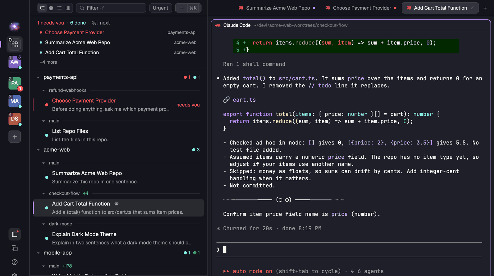
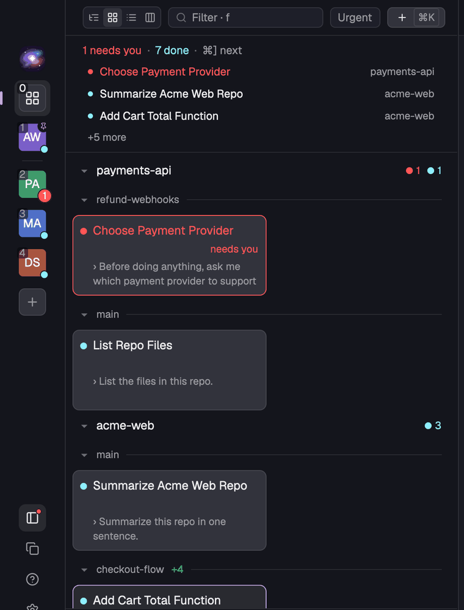
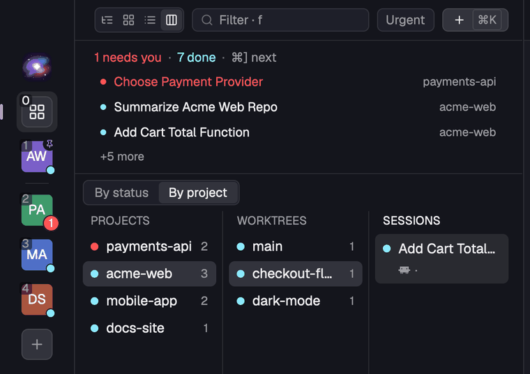
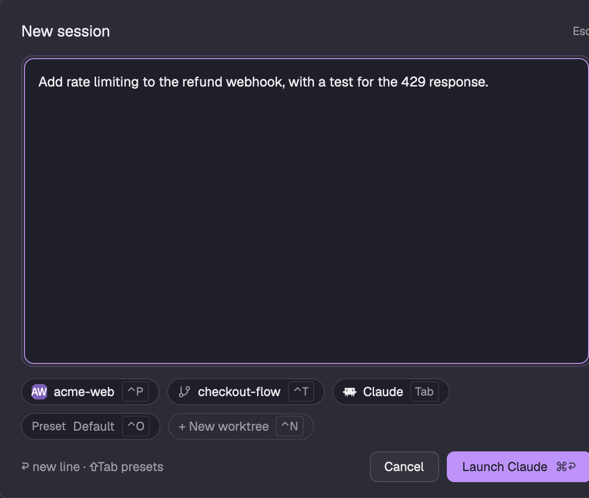
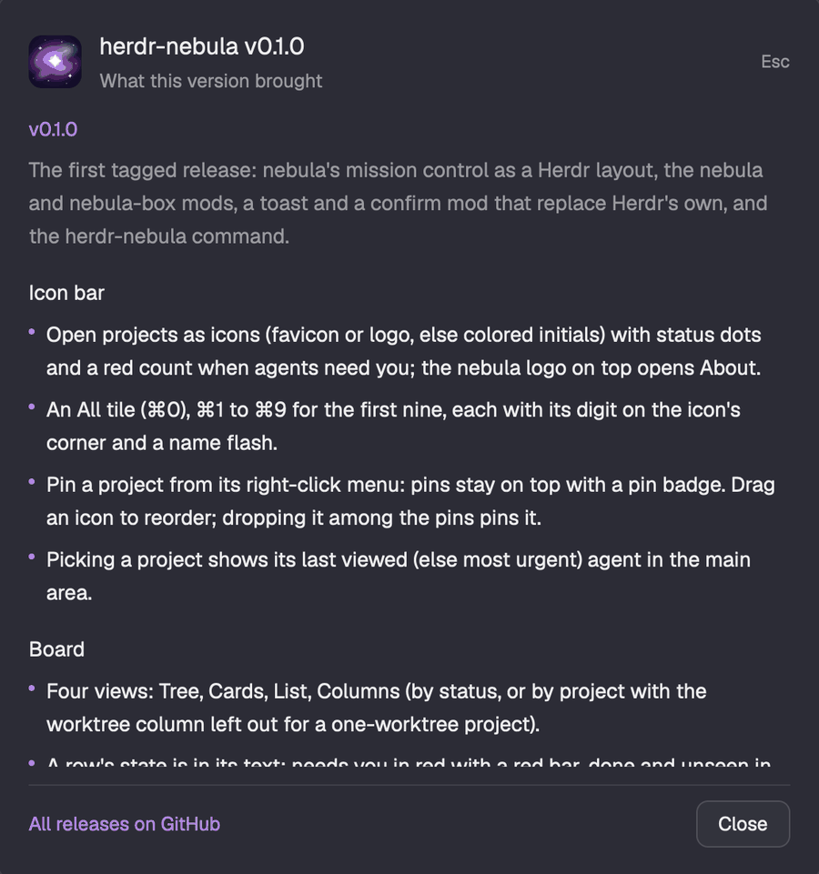

# Changelog

## v0.1.0 (2026-11-10)

The first tagged release: nebula's mission control as a Herdr layout, the `nebula` and `nebula-box` mods, and the `herdr-nebula` command.

### Icon bar
- Open projects as icons (favicon or logo, else colored initials) with status dots and a red count when agents need you; the nebula logo on top opens About.
- An All tile (⌘0), ⌘1 to ⌘9 for the first nine, each with its digit on the icon's corner and a name flash.
- Pin a project from its right-click menu: pins stay on top with a pin badge. Drag an icon to reorder; dropping it among the pins pins it.
- Picking a project shows its last viewed (else most urgent) agent in the main area.

### Board
- Four views: Tree, Cards, List, Columns (by status, or by project with the worktree column left out for a one-worktree project).
- A row's state is in its text: needs you in red with a red bar, done and unseen in bold with a cyan age, seen muted. An attention strip lists who waits; worktrees with an agent that needs you sort first.
- A click shows an agent and keeps the keys on the board; Enter or a double click steps in.
- Ports an agent's programs listen on show as links (`:3000`); a click opens them.
- Quiet rows: the agent and model show only where they differ.
- A live status line (`2 need you · ⌘] go · ⌘J jump`) with a KEYS / TERMINAL keycap.
- Open a session's folder in any installed editor (Zed, Cursor, VS Code, Windsurf, Sublime Text, WebStorm, Xcode) or reveal it in Finder.
- Resume after an exit or a reboot, idle agents sleep, nebula's own sessions show and resume, and the ⌘J palette jumps to any agent.

 

### New session
- ⌘K anywhere (p on the board): the task first, the project, checkout, agent and preset as pills, a new `wt` worktree inline. ⌘↩ launches, ↩ is a new line.
- Paste an image (⌘V or ⌘⇧V): it shows as a thumbnail and the agent's task names the file.
- A new session's tab is named from its task until the agent titles itself.

### Motion
- Claude Code's star spinner on working agents, a bobbing agent icon, a nudge and a breathing bar for needs you, a dot that pops when done, sliding selection and view pills, an attention strip that springs open, rows that fade in. Settings, Look, Reduce motion turns it all off.

### Settings and updates
- Settings, Look: Text size (90% to 140% of the terminal's text size) and Reduce motion.
- Update checks on start and once a day: "herdr-nebula vX is ready" with Update and What changed, a dot on the Settings gear, and an Updates row; What changed shows the release notes. `herdr-nebula update` pulls and reinstalls into every Herdr window.

### Development
- Bun for the package manager and tests (`bun run check`), Node 22 still runs the CLI and hooks; CI runs both.
- Releases: `bun run release:draft` drafts the notes from the commits, `bun run release:publish` tags, and a workflow publishes the GitHub release.
