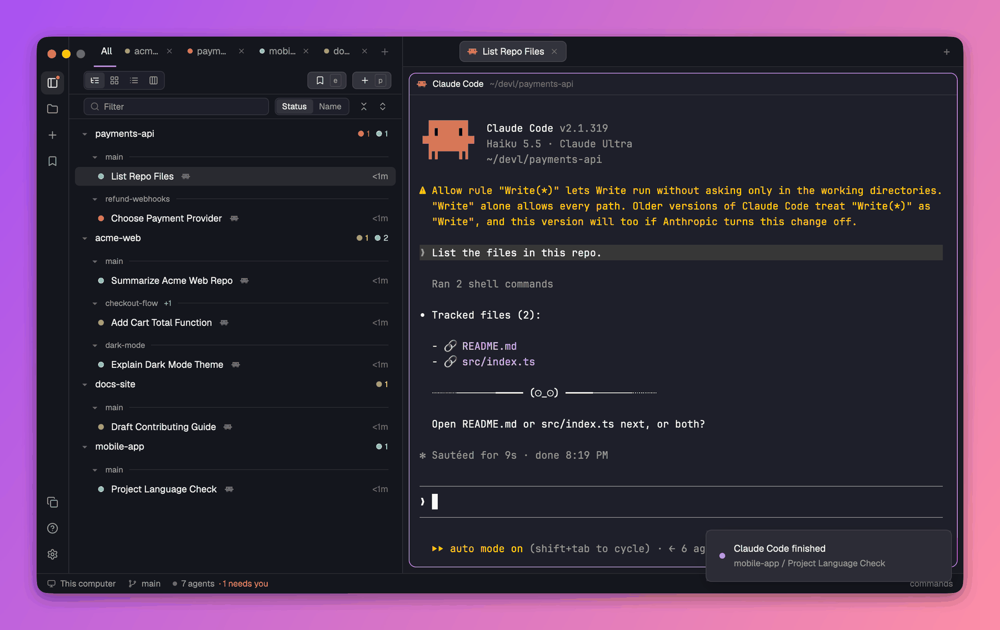
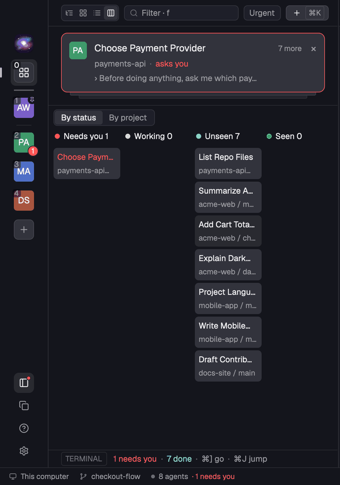
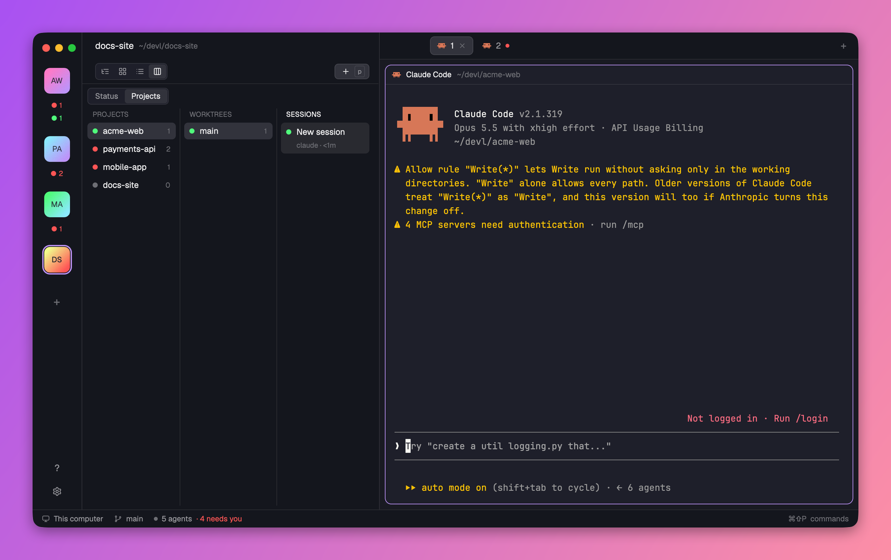
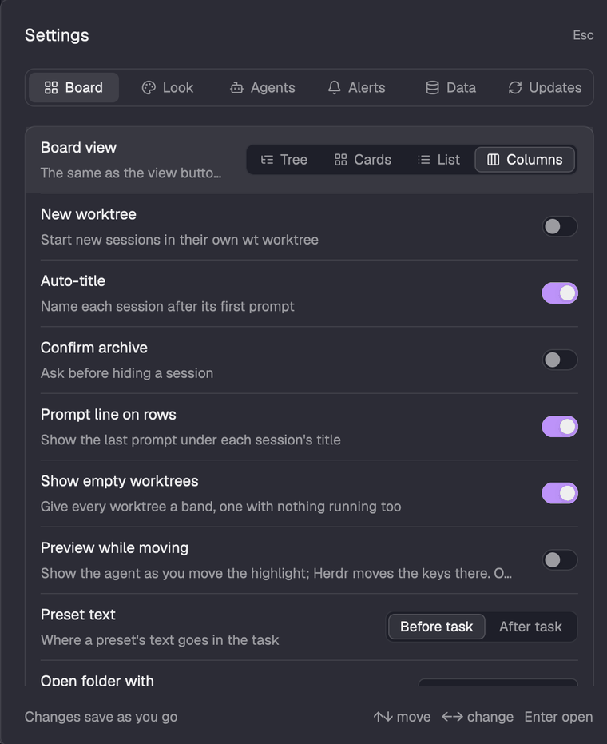
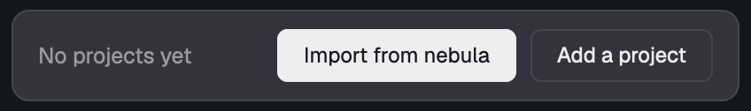

<div align="center">


# herdr-nebula

**[nebula](https://github.com/AgentSystemLabs/nebula)'s mission control, inside [Herdr](https://herdr.dev).**

Every coding agent you run, on one board: open projects as tabs, their worktrees and sessions beside them,
and Herdr's own terminal next to it all.

```sh
curl -fsSL https://raw.githubusercontent.com/kaminskypavel/herdr-nebula/main/install.sh | sh
```



</div>

## Why

I'm a huge fan of [nebula](https://github.com/AgentSystemLabs/nebula). Its model (project, then worktree, then session), the one-key task box and the four status colors are how I run six to fifteen agents a day.

I like [Herdr](https://herdr.dev) too: a native window, real panes, and terminals that keep running after you close it.

So herdr-nebula brings nebula's workflow into Herdr, as a layout and two mods. Nothing to choose between.

## What you get

- **Project tabs.** Git repos or plain folders. The projects you have open live in the icon bar, like a vertical workspace switcher: the nebula logo (it opens About: version, updates, the repo), an **All** tile (<kbd>⌘0</kbd>), then one icon per open project (its favicon or logo, else colored initials), in a stable order that picking a project never changes; drag an icon to reorder (dropping it among the pins pins it, below them unpins it). The selected one has an accent bar on the left; hover for the name. When more projects are open than fit, the list scrolls and the bottom buttons stay put. Right-click a project for **Pin to top**, **Close** (or **Remove from list...**). Pinned projects come first, each with a small pin on its corner and a line under the group, and take <kbd>⌘1</kbd> onward. <kbd>+</kbd> opens the projects picker (search, session counts, a check on the open ones, and "Add a project"). A closed project whose agent needs you opens as a tab by itself, and <kbd>+</kbd> carries a red dot until it does.
- **One rule for every view.** The selected tab scopes Tree, Cards, List and Columns alike: a project tab shows that project alone, All shows every open project grouped by project, with sessions outside any project at the end. The filter and the sort work inside the tab. When you open an agent in the main panel (or jump with <kbd>⌘]</kbd>), the board selects that agent's project tab and highlights it; on All it stays on All.
- **An icon bar.** A thin bar on the left: Board (show or fold it), the project tabs (All, your open projects, <kbd>+</kbd>), and at the bottom New window, Shortcuts and Settings. The board's top row is one slim line: the four view icons, the filter, the sort (Urgent or A–Z) and New session (<kbd>⌘K</kbd> opens it anywhere). Presets are on <kbd>t</kbd> and inside the New session box.
- **A board in four views.** Tree, Cards, List and Columns. Columns groups by status, or nebula-style as Projects, Worktrees, Sessions (the switch above it reads By status and By project).
- **Status at a glance.** 🔴 needs you, 🟡 working, 🔵 done and not seen yet, 🟢 done and seen.
- **Needs you is loud.** A project's icon carries a red count of the agents waiting on you. A row says its state in words too: a session that needs you has a red bold title, a red bar on its left edge and "needs you" on the right; one that finished unseen has a bold title and a cyan age; one you have seen is muted. A status dot pulses only for five seconds after its state changed (a session started needing you, started working, or finished unseen: red hard, yellow gently, cyan) and then holds still; nothing pulses forever. The shortcuts sheet (<kbd>?</kbd>) has a color legend. Tree and List rows show the last prompt under the title (Settings: Prompt line on rows); a session not yet titled shows its prompt as the title.
- **Up next.** One card on top of the board names the agent that most deserves you, across every open project: its project icon, the session, `payments-api · asks you · 2m`, and what it last said (its question, or the first line of its last reply), with **Go** (<kbd>⌘]</kbd>) and **Clear** (<kbd>e</kbd>), then `3 more: ...`. Needs you comes first, then finished, newest first. Opening an agent clears it; <kbd>e</kbd> clears it without going and <kbd>⇧E</kbd> clears everything waiting; a cleared agent comes back when it changes state. Nothing waiting, no card. The status line counts the same queue.
- **A calm icon bar.** Project icons carry no dots: a red count only when an agent there needs you, and a cyan ring for ten minutes after one finishes, fading out. The icon hops once when one of its agents starts waiting (Settings, Look, Reduce motion turns it off).
- **Coming back.** When you return to Herdr after a minute or more away (another app, or a locked screen; switching between two Herdr windows does not count), a card lists what finished or asked meanwhile: <kbd>↩</kbd> goes, <kbd>Esc</kbd> later. While you are away, a macOS notification says who and what, and a click opens that agent (needs `terminal-notifier` from Homebrew, allowed in System Settings, Notifications). Settings, When you're away: macOS notification and the card, the card only, or neither. Herdr's own popup is unaffected.
- **Rows say what it did.** A session that needs you or finished shows the agent's line instead of your prompt, and a session named like its project shows its task as the title. Cards are all one size: title and age, the agent and model, two lines of what it said, and one line for its subagents.
- **Quiet rows.** A row shows its agent icon and model only when it is the highlighted one, or when it runs something other than its project's usual agent and model; the common case stays plain. On a wide board a Tree or List row's content stops at about 560 px, so the age sits next to the title (ports stay at the right edge).
- **Every worktree has a band.** One with nothing running reads "nothing running · ⌘K new session · d delete worktree": <kbd>⌘K</kbd> (or <kbd>p</kbd>) starts a session there, <kbd>d</kbd> removes the worktree after the same uncommitted/unpushed check (never the repo's own checkout or the default branch). Settings: Show empty worktrees.
- **A new-session box** (<kbd>⌘K</kbd> anywhere; <kbd>p</kbd> also works on the board). With the board holding the keys it opens at the highlighted project and worktree, from an agent at that agent's project. The task is the big field up top; under it the project, checkout, agent (only the installed ones) and preset are pills (each shows its key: <kbd>⌃P</kbd> <kbd>⌃T</kbd> <kbd>Tab</kbd> <kbd>⌃O</kbd>), and a dashed `+ New worktree` pill (<kbd>⌃N</kbd>) starts it in a fresh [`wt`](https://github.com/max-sixty/worktrunk) worktree, with the branch name inline. The Launch button names the agent. Paste an image (<kbd>⌘V</kbd> with an image on the clipboard, or <kbd>⌘⇧V</kbd>) and it shows as a thumbnail; on launch the agent's task ends with `Images: /path/a.png ...` so it reads them. Pastes live in `nebula-pastes/` under the Herdr app folder, and ones older than 7 days are deleted when the box opens. <kbd>Esc</kbd> keeps what you typed for the next open, <kbd>⌘↩</kbd> launches (a plain <kbd>↩</kbd> is a new line), and a <kbd>⌘↩</kbd> pressed while the box is still loading launches as soon as it is ready.
- **Presets shared with nebula.** Same `agent_presets.json`, so both tools see the same list.
- **One-click import from nebula.** Your projects and per-agent defaults, straight from nebula's own files.
- **Sessions that name themselves.** Claude Code and Codex title their tab after the first prompt. A name you give always wins.
- **Row actions.** Rename, archive, relaunch with the same setup, open the folder, or delete. Delete offers to remove the worktree and shows uncommitted files and unpushed commits first.
- **Resume after an exit, a crash or a reboot.** The prompt hook saves each Claude Code and Codex conversation id on its terminal (the `nebula.session` label). When the agent has left the shell, its row reads "exited · Enter resumes", and <kbd>↩</kbd>, a click or <kbd>⇧R</kbd> types `claude --resume <id>` (or `codex resume <id>`, with the row's model and effort) into the same terminal. After a reboot or a core restart Herdr gives each lost terminal a shell in its last folder, so the same row picks the conversation back up.
- **Updates.** The icon bar checks GitHub on start and once a day; a new version comes as a popup beside it ("herdr-nebula v0.2.0 is ready" with Update and What changed) and a dot on the Settings gear; What changed shows the release notes. A click, Settings' Update, or `herdr-nebula update` pulls it and reinstalls into every Herdr window; `herdr-nebula update --check` only reports. A copy with its own commits or edits is never updated for you.
- **Text size.** The panels' text follows the terminal's size in Herdr's settings; Settings, Look, Text size scales it further (90% to 140%).
- **Open in your editor.** A session's right-click menu offers every editor installed on the Mac (Open in Zed, Cursor, VS Code, Windsurf, Sublime Text, WebStorm, Xcode) and Reveal in Finder; <kbd>⇧↩</kbd> opens the first, or the command set in Settings.
- **Ports.** A session shows the TCP ports its programs listen on (`:3000 :5173`), a dev server its agent started included, like cmux's sidebar. Click one (at the right end of the row, or on the card) to open `localhost:<port>` in the browser; the row's right-click menu has **Open localhost:3000** too. The board looks every 5 seconds while it is shown (`lsof`, matched to the terminal by the `HC_TERMINAL_ID` each program inherits).
- **Motion that means something.** A working row shows Claude Code's star spinner (`· ✢ ✳ ✶ ✻ ✽`) in place of its dot, and its agent icon bobs. A session that starts needing you nudges once, then its red bar breathes until you look at it; a dot that turns done pops once; a new session row fades in and rises. The icon bar's accent marker and the view switcher's pill spring to the pick, the attention strip slides open and shut, and the toast and the ⌘1 to ⌘9 flash fade in. Everything runs natively (no timers), settles in a fraction of a second and stops when nothing changes, except the spinner and the needs-you breathing. **Reduce motion** in Settings (Look) turns all of it off.
- **Idle agents sleep.** An agent that is done and seen, has a conversation to resume, and has been out of view (not in the shown tab, not pinned) for 15 minutes gets its CLI stopped to free memory: the terminal stays as a shell, and the row reads "asleep · Enter resumes". Settings, Agents: Sleep idle agents after (Off, 5, 15, 30 or 60 minutes). <kbd>z</kbd> (or the right-click menu) sleeps the highlighted agent now; one that is working, needs you or has no conversation id yet is left alone, with a note saying why.
- **A second window.** The New window button on the icon bar opens another Herdr window on the same agents, for two boards side by side.
- **Keys stay on the board.** <kbd>j</kbd> <kbd>k</kbd> and <kbd>Tab</kbd> <kbd>⇧Tab</kbd> only move the highlight. A click shows the agent in the main area and the keys stay on the board; <kbd>↩</kbd> or a double click steps in (the keys go to its terminal). Settings, Preview while moving, shows the agent as you move instead (Herdr then hands the keys to it).
- **You can see who has the keys.** A keycap at the left end of the status line reads **KEYS** (accent) while the board has the keyboard and a dim **TERMINAL** when the terminal does (**FILTER** while you type in the filter). <kbd>Esc</kbd> hands the keys back to the terminal and keeps the board shown; <kbd>⌃`</kbd> still folds it.
- **A status line that follows you.** While the terminal has the keys it says what waits: `2 need you · ⌘] go · ⌘J jump`, `1 done · ⌘J jump`, or `All quiet · ⌘K new session` (your live key bindings; counts are across the open projects). While the board has the keys it lists at most four keys for where you are (a row, an empty worktree, the filter, Columns) and `? more`. After an action it says what happened for three seconds: "Archived 'Fix login' · u undo", "Started in api / feat-x", "Renamed", "Asleep: ...", "Resuming ...", "Nothing waiting". <kbd>u</kbd> with no archived row under the cursor takes back the last archive. <kbd>?</kbd> opens the shortcuts list.
- **Jump to any agent.** <kbd>/</kbd> on the board, or <kbd>⌘J</kbd> anywhere, opens a palette over every project, open or closed. It lists `project / title` with a status dot and age, needs-you first, then working, unseen and the most recent; typing fuzzy-filters (nebula's matcher, so `api fix` finds `api / fix login`). <kbd>↩</kbd> selects the project's tab (opening it if closed) and steps into the agent. <kbd>Esc</kbd> clears the query first, then closes. The filter in the top row stays: click it or press <kbd>f</kbd>.
- **Keyboard first.** <kbd>⌃`</kbd> hands the keys to the board and folds it. <kbd>⌘]</kbd> jumps to the next agent that needs you, from anywhere, and a toast says when nobody does.

<table>
<tr>
<td width="33%"></td>
<td width="33%"></td>
<td width="33%"></td>
</tr>
<tr>
<td align="center">Columns by status</td>
<td align="center">Columns, nebula-style</td>
<td align="center">Settings</td>
</tr>
</table>

## Install

You need the [Herdr app](https://herdr.dev) and Node 22 or newer. [`wt`](https://github.com/max-sixty/worktrunk) is optional, for new worktrees.

```sh
curl -fsSL https://raw.githubusercontent.com/kaminskypavel/herdr-nebula/main/install.sh | sh
```

That clones herdr-nebula into `~/.local/share/herdr-nebula`, installs the two mods and the `nebula` layout into `~/.config/herdr-app`, adds the layout's keys, links the `herdr-nebula` command into `~/.local/bin`, adds the auto-title hook to Claude Code and Codex (with backups), and switches Herdr to the layout. In Codex, approve the hook once with `/hooks`.

Updates come by themselves: the icon bar offers a new version in a popup (or run `herdr-nebula update`). What changed in each version is in [CHANGELOG.md](CHANGELOG.md) and on the [releases page](https://github.com/kaminskypavel/herdr-nebula/releases).

## Coming from nebula?



- **Bring your projects.** Click **Import from nebula** on the empty board, or Settings, Data, Import. It reads nebula's own files: your projects and per-agent defaults. Nothing in nebula changes.
- **Presets just work.** herdr-nebula reads and writes nebula's `agent_presets.json`, so both tools share one list.
- **Same keys, same colors.** <kbd>p</kbd> opens the new-session box (<kbd>^P</kbd> <kbd>^T</kbd> <kbd>Tab</kbd> <kbd>^O</kbd> as in nebula), worktrees land in `<repo>-worktrees/<branch>` via `wt`, and the status colors mean the same. Running sessions stay in nebula; start new ones here.

## Keys

| Where    | Key                                                 | Does                                                 |
| -------- | --------------------------------------------------- | ---------------------------------------------------- |
| Anywhere | <kbd>⌃`</kbd>                                       | Board takes the keys; again folds it                 |
| Anywhere | <kbd>⌘]</kbd> <kbd>⌘[</kbd>                         | Next, previous session that needs you                |
| Anywhere | <kbd>⌘K</kbd>                                       | New session                                          |
| Anywhere | <kbd>⌘J</kbd>                                       | Jump to any agent in any project                     |
| Anywhere | <kbd>⌘0</kbd>, <kbd>⌘1</kbd> to <kbd>⌘9</kbd>      | All projects, or the nth project (in this layout ⌘0 is no longer Herdr's zoom reset) |
| Anywhere | <kbd>⌘1</kbd> to <kbd>⌘9</kbd>                      | Select a project in the icon bar                     |
| Board    | <kbd>j</kbd> <kbd>k</kbd>, <kbd>Tab</kbd> <kbd>⇧Tab</kbd> | Move the highlight; <kbd>↩</kbd> opens the agent |
| Board    | a click                                              | Show the agent; the keys stay on the board           |
| Board    | <kbd>↩</kbd>, or a double click                     | Step into the agent (the keys go to its terminal)    |
| Board    | <kbd>Esc</kbd>                                      | Give the keys back to the terminal, board stays      |
| Board    | <kbd>/</kbd> <kbd>f</kbd> <kbd>?</kbd>              | Jump to any agent, filter, shortcuts                 |
| Board    | <kbd>.</kbd> <kbd>,</kbd>, <kbd>;</kbd>             | Next, previous needs-you; next done and not seen yet |
| Board    | <kbd>p</kbd> <kbd>e</kbd> <kbd>v</kbd>              | New session, presets, next view                      |
| Board    | <kbd>o</kbd> <kbd>m</kbd>                           | Sort (Urgent or A–Z), Columns by status or project   |
| Board    | <kbd>-</kbd> <kbd>=</kbd>                           | Fold all, expand all (project headers on All, worktree bands on a project tab) |
| Board    | <kbd>r</kbd> <kbd>a</kbd> <kbd>u</kbd> <kbd>d</kbd> | Rename, archive, unarchive (or undo), delete         |
| Board    | <kbd>⇧R</kbd>, or <kbd>↩</kbd> on an exited row     | Resume an exited or asleep agent's conversation      |
| Board    | <kbd>z</kbd>                                        | Sleep the agent now (stops its CLI; <kbd>↩</kbd> resumes) |
| Board    | <kbd>s</kbd>, or shift-click                        | Pin the agent beside the active one (again to unpin) |
| Board    | <kbd>0</kbd>, <kbd>1</kbd> to <kbd>9</kbd>          | Select the All tab, or an open project tab           |

The <kbd>?</kbd> button on the icon bar lists them all, live.

## Roll back

Switch back with <kbd>⌘⇧L</kbd>. The hooks (prompt, and for Claude Code the sub-agent start and stop) are the groups tagged `_herdrNebulaManaged` in `~/.claude/settings.json` and `~/.codex/hooks.json`, with backups beside each file.

## Develop

Plain JavaScript (Herdr mods run JS); `tsc` only type-checks it. [Bun](https://bun.sh) is the package manager: `bun install` once, then `bun run check` runs lint (Biome), the format check, the type check (`tsc`, against loose stand-ins for the Herdr modules in `types/`) and the tests (`bun test`). `bun run test:node` runs them under Node 22, which the CLI and hooks ship for. `bun run format` fixes formatting. CI runs `bun run check` and `bun run test:node` on every push to main and every pull request.

`herdr-app check mods/nebula` checks the board mod. After `scripts/install.sh`, `herdr-app check mods/nebula-box` checks the box mod too.

Releasing: `bun run release:draft` writes the next CHANGELOG section from the commits since the last tag (features and fixes by area, a minor step with features, else a patch step) and sets the version; edit it, then `bun run release:publish` commits, tags and pushes, and the Release workflow publishes the GitHub release with that section. Installed copies then offer it as "herdr-nebula vX is ready" with Update and What changed. A push to main is not a release: installed copies offer it as "herdr-nebula update is ready", so release when a batch of changes deserves notes, not on every push. Screenshots for the notes come from a demo window with made-up projects, never a real one, and go in `assets/releases/vX/`.

---

<div align="center">

Developed by [Pavel "PK" Kaminsky](https://pavel-kaminsky.com) · Built on [Herdr](https://herdr.dev) · Inspired by [nebula](https://github.com/AgentSystemLabs/nebula)

MIT licensed. Icons from [Lucide](https://lucide.dev) (ISC).

</div>
