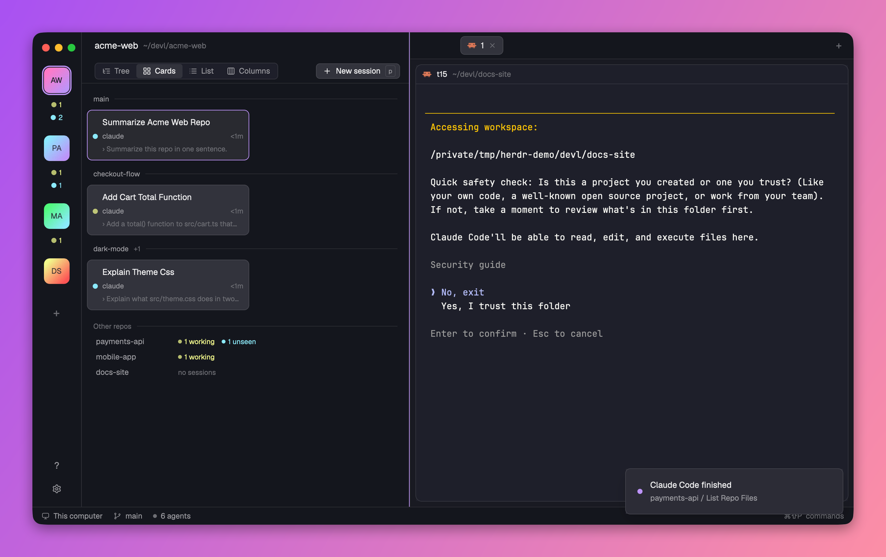
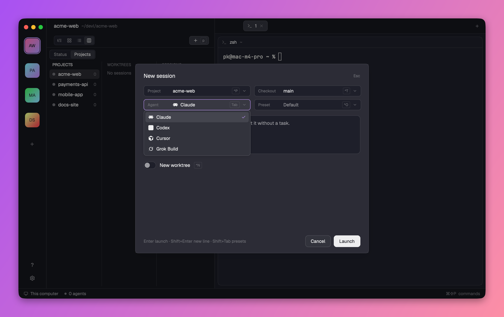

<div align="center">

# herdr-nebula

**[nebula](https://github.com/AgentSystemLabs/nebula)'s mission control, inside [Herdr](https://herdr.dev).**

Every coding agent you run, on one board: projects on a rail, their worktrees and sessions beside them,
and Herdr's own terminal next to it all.

```sh
curl -fsSL https://raw.githubusercontent.com/kaminskypavel/herdr-nebula/main/install.sh | sh
```



</div>

## Why

I'm a huge fan of [nebula](https://github.com/AgentSystemLabs/nebula). Its model (project, then worktree, then session), the one-key task box and the four status colors are how I run six to fifteen agents a day.

I like [Herdr](https://herdr.dev) too: a native window, real panes, and terminals that keep running after you close it.

So herdr-nebula brings nebula's workflow into Herdr, as a layout and two mods. Nothing to choose between.

## What you get

- **A rail of projects.** Git repos or plain folders, each tile with a count of its sessions by status. Click a count to jump to that session.
- **A board in four views.** Tree, Cards, List and Columns. Columns groups by status, or nebula-style as Projects, Worktrees, Sessions.
- **Status at a glance.** 🔴 needs you, 🟡 working, 🔵 done and not seen yet, 🟢 done and seen.
- **A new-session box** (<kbd>⌘K</kbd> or <kbd>p</kbd>). Pick the project, checkout, agent (only the installed ones) and preset, type the task, and optionally start it in a fresh [`wt`](https://github.com/max-sixty/worktrunk) worktree.
- **Presets shared with nebula.** Same `agent_presets.json`, so both tools see the same list.
- **One-click import from nebula.** Your projects and per-agent defaults, straight from nebula's own files.
- **Sessions that name themselves.** Claude Code and Codex title their tab after the first prompt. A name you give always wins.
- **Row actions.** Rename, archive, relaunch with the same setup, open the folder, or delete. Delete offers to remove the worktree and shows uncommitted files and unpushed commits first.
- **A second window.** The window button on the rail opens another Herdr window on the same agents, for two boards side by side.
- **Keyboard first.** <kbd>⌃`</kbd> hands the keys to the board and back. <kbd>⌘]</kbd> jumps to the next agent that needs you, from anywhere.

<table>
<tr>
<td width="50%"></td>
<td width="50%"></td>
</tr>
<tr>
<td align="center">Columns, nebula-style</td>
<td align="center">The new-session box</td>
</tr>
</table>

## Install

You need the [Herdr app](https://herdr.dev) and Node 22 or newer. [`wt`](https://github.com/max-sixty/worktrunk) is optional, for new worktrees.

```sh
curl -fsSL https://raw.githubusercontent.com/kaminskypavel/herdr-nebula/main/install.sh | sh
```

That clones herdr-nebula into `~/.local/share/herdr-nebula`, installs the two mods and the `nebula` layout into `~/.config/herdr-app`, adds the layout's keys, links the `herdr-nebula` command into `~/.local/bin`, adds the auto-title hook to Claude Code and Codex (with backups), and switches Herdr to the layout. Run it again to update. In Codex, approve the hook once with `/hooks`.

## Coming from nebula?


- **Bring your projects.** Click **Import from nebula** on the empty board, or Settings, Data, Import. It reads nebula's own files: your projects and per-agent defaults. Nothing in nebula changes.
- **Presets just work.** herdr-nebula reads and writes nebula's `agent_presets.json`, so both tools share one list.
- **Same keys, same colors.** <kbd>p</kbd> opens the new-session box (<kbd>^P</kbd> <kbd>^T</kbd> <kbd>Tab</kbd> <kbd>^O</kbd> as in nebula), worktrees land in `<repo>-worktrees/<branch>` via `wt`, and the status colors mean the same. Running sessions stay in nebula; start new ones here.

## Keys

| Where | Key | Does |
|---|---|---|
| Anywhere | <kbd>⌃`</kbd> | Board takes the keys; again hands them back |
| Anywhere | <kbd>⌘]</kbd> <kbd>⌘[</kbd> | Next, previous session that needs you |
| Anywhere | <kbd>⌘K</kbd> | New session |
| Board | <kbd>j</kbd> <kbd>k</kbd>, <kbd>↩</kbd> or a click | Move, show the agent |
| Board | <kbd>p</kbd> <kbd>e</kbd> <kbd>v</kbd> | New session, presets, next view |
| Board | <kbd>r</kbd> <kbd>a</kbd> <kbd>u</kbd> <kbd>d</kbd> | Rename, archive, unarchive, delete |
| Board | <kbd>s</kbd>, or shift-click | Pin the agent beside the active one (again to unpin) |
| Board | <kbd>1</kbd> to <kbd>9</kbd> | Pick a project |

The <kbd>?</kbd> on the rail lists them all, live.

## Roll back

Switch back with <kbd>⌘⇧L</kbd>. The hooks (prompt, and for Claude Code the sub-agent start and stop) are the groups tagged `_herdrNebulaManaged` in `~/.claude/settings.json` and `~/.codex/hooks.json`, with backups beside each file.

## Develop

`node --test` runs the tests; `herdr-app check mods/nebula` checks the board mod.

---

<div align="center">

Developed by [Pavel "PK" Kaminsky](https://pavel-kaminsky.com) · Built on [Herdr](https://herdr.dev) · Inspired by [nebula](https://github.com/AgentSystemLabs/nebula)

MIT licensed. Icons from [Lucide](https://lucide.dev) (ISC).

</div>
